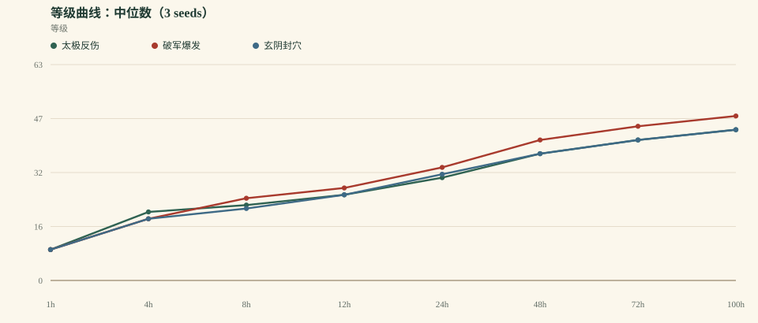
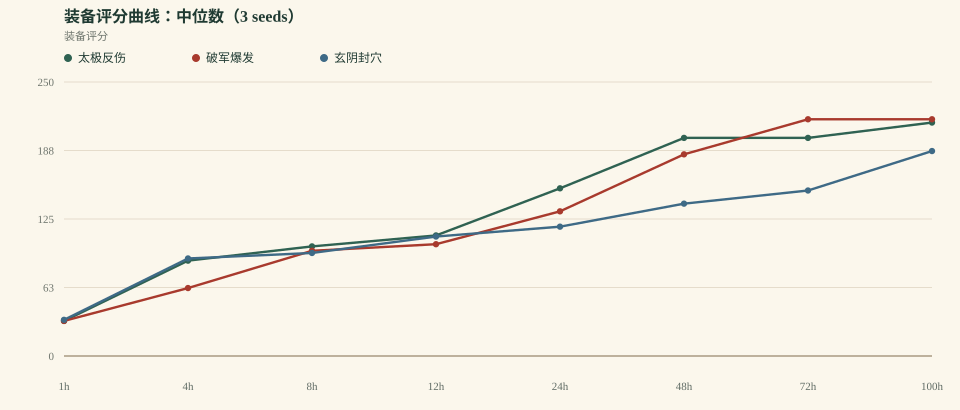
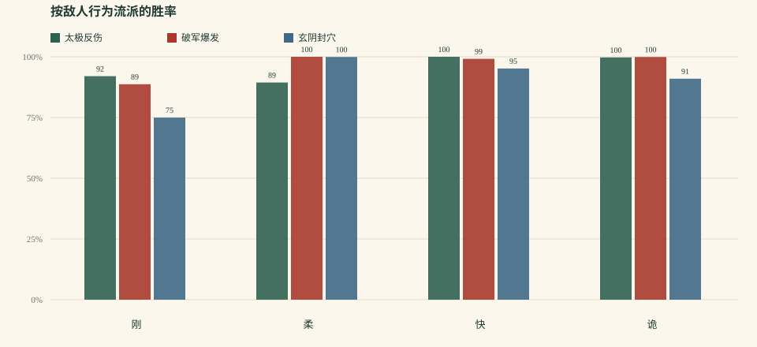

# 《一纸江湖》平衡模拟 v0.1

> 生成时间：2026-10-17T17:46:27.041Z  
> 规模：3 套 build × 3 seeds × 100h 连续模拟  
> 模型：0.1.0 · 自动战斗 / 自动升级 / 自动装备 / 自动突破  
> 原始数据：`balance-v0.1.json`、`balance-v0.1.csv`

## 0. 先说结论

这一轮跑出来的不是“平衡完成”，而是一个**可调的系统基线**。最重要的发现是：**当前按“每场战斗”发奖励，天然奖励快速 build，破军因此获得复利；太极则因为打得太慢，被 40 回合上限和低 DPS 卡住。** 这需要在下一轮改奖励结构，而不是只改几个系数。

- 100h 中位等级：**太极反伤 44** / **破军爆发 48** / **玄阴封穴 44**
- 最快/最慢刷图效率：**1.59×**
- 100h 后最高地图：太极反伤 5 图 10 层 / 破军爆发 6 图 10 层 / 玄阴封穴 5 图 10 层
- 当前结论：**不满足“没有一套通吃”的平衡目标**；下一轮优先改奖励归一化与太极 DPS/胜利条件。

## 1. 方法与机器人策略

- 3 套 build：太极反伤、破军爆发、玄阴封穴。
- 3 个随机种子（1, 2, 3），每套连续模拟 100 小时。
- 机器人策略：选当前最高可用地图；层数不超过“本境等级 +2”；4 连胜推一层；失败退一层；3 连败换上一张图；自动穿最高评分装备、自动淬炼、自动突破。
- 单场时间：8s + 2s × 回合数；首领额外 20s。这个时间只影响“每小时能打多少场”，不影响单场胜负。
- 关键限制：没有真人操作、没有事件/门派/同伴任务、没有走位与驱散、没有传奇效果；这是系统骨架测试，不是最终玩家体验。

## 2. 关键里程碑

| Build | 三流 | 二流 | 一流 | 绝顶 | 宗师 | 传说 |
| --- | --- | --- | --- | --- | --- | --- |
| 太极反伤 | 1.1h (3/3) | 2.8h (3/3) | 17.8h (3/3) | 45.6h (3/3) | — (0/3) | — (0/3) |
| 破军爆发 | 3.0h (3/3) | 4.2h (3/3) | 12.3h (3/3) | 30.6h (3/3) | 73.3h (3/3) | — (0/3) |
| 玄阴封穴 | 1.4h (3/3) | 5.9h (3/3) | 16.7h (3/3) | 44.3h (3/3) | — (0/3) | — (0/3) |

> 格式：中位到达时间 / 到达人数。3 seeds 下，空白或 “—” 表示没有种子到达该境界。

## 3. 100h 终局

| Build | 中位等级 | 境界 | 装备评分 | 总场次 | 总败场 | 近期胜率 | 平均回合 | 最长停滞 | 最高地图 |
| --- | --- | --- | --- | --- | --- | --- | --- | --- | --- |
| 太极反伤 | 44 | 4 · 绝顶 | 213 | 11306 | 269 | 100.0% | 34.3 | 7.8 | 5 图 / 10 层 |
| 破军爆发 | 48 | 5 · 宗师 | 216 | 17965 | 362 | 100.0% | 4.4 | 12.6 | 6 图 / 10 层 |
| 玄阴封穴 | 44 | 4 · 绝顶 | 187 | 14285 | 1240 | 88.0% | 9.6 | 6.2 | 5 图 / 10 层 |

## 4. 刷图效率与产出

| Build | 场次/小时 | 平均回合 | 银两 | 名望 | 终局装备稀有度（3 runs × 6 槽） |
| --- | --- | --- | --- | --- | --- |
| 太极反伤 | 113.0 | 34.3 | 172244 | 23805 | 神:13 绝:5 |
| 破军爆发 | 179.6 | 4.4 | 389532 | 36952 | 神:16 绝:2 |
| 玄阴封穴 | 142.8 | 9.6 | 193970 | 19529 | 神:10 绝:8 |

**解读**：场次/小时 × 每场奖励 = 实际成长速度。只要奖励按每场发，刷得快的 build 会同时拿到更多修为、银两、装备和声望；建议先做“回合/时长系数”，再谈纯数值平衡。

## 5. 按敌人行为流派的胜率

| Build | 刚 | 柔 | 快 | 诡 |
| --- | --- | --- | --- | --- |
| 太极反伤 | 92.0% (2843) | 89.4% (5203) | 100.0% (9016) | 99.7% (16926) |
| 破军爆发 | 88.7% (9269) | 100.0% (7114) | 99.2% (8969) | 99.9% (27462) |
| 玄阴封穴 | 75.0% (3719) | 99.9% (6749) | 95.2% (9470) | 91.0% (23144) |

> 括号内是该流派在全部 run 中的总样本场次；这里统计的是整段 100h 的总胜率，不是“最近 50 场”。机器人会退回安全层，所以总数会被保守策略影响。

## 6. 曲线

## 7. 发现

1. **曲线成立但还不平衡。** 100h 中位等级：太极反伤 44 / 破军爆发 48 / 玄阴封穴 44；等级差 8.3%。这不是“平衡通过”，而是可调基线。
2. **速度收益过高。** 太极反伤 113.0 场/小时 / 破军爆发 179.6 场/小时 / 玄阴封穴 142.8 场/小时；最快/最慢 1.59×。当前奖励按“每场”发，快速 build 会同时获得更多修为、银两、装备和声望，形成复利。
3. **太极是“能扛但打不动”。** 100h 中位回合 34.3，明显高于破军；40 回合上限会把它卡在中层。要么补伤害/内力循环，要么给坦系一个独立胜利条件（例如存活/护镖/守关）。
4. **破军仍是最快曲线。** 它的等级、场次/小时、地图推进都领先；需要加风险或削弱“无脑快”的收益，而不是只削数值。
5. **装备到 100h 已经接近满稀有。** 中位装备评分 213 左右，神/绝装占比高；下一轮要么降低掉落、要么把“毕业”做成更长线的词条/淬炼目标。
6. **玄阴的失败场次最高。** 中位失败 1240 场；控制和毒在高层容错低，需要检查控制命中、持续伤害与保命手段。
7. **机器人太保守，近期胜率偏高。** 它会在安全层反复刷，近期胜率接近 100%；这不代表内容简单，而是“推层”策略不够激进。下一轮需要加一个“冲层/首领挑战”策略做上限测试。

## 8. 下一轮调整建议（按优先级）

1. **奖励按战斗时长/回合归一化**：XP/银两/装备概率乘一个与回合数相关的系数，避免“越快越富”单一最优；先做小系数（如 1+0.02×rounds），用模拟器验证。
2. **太极补输出或换胜利条件**：提高云手/揽雀尾的伤害或内力循环；如果坚持“坦”，给守关、护镖、生存类目标独立奖励，不要让它只能靠慢磨。
3. **破军加风险**：提高高层精英/首领的爆发与破防，或让“速刷”在高层更难；测试其胜率是否降到 75–85%。
4. **装备掉落分层**：24h/100h 的稀有度曲线需要重做；把“神装”设为多周目标，而不是 100h 内自然满。
5. **加一个激进 bot**：每次 5 胜就冲下一层，连续 3 败才退；用它测上限，而不是只用保守 bot。
6. **扩到 5 套 build、更多敌人风格**：当前只有 3 套；先验证曲线，再扩 content。

## 9. 模型边界

- 只有 3 套 build，自动优先级是硬编码启发式，不是玩家真实决策。
- 装备自动穿最优、自动淬炼、无套装收集选择；传奇效果尚未进入战斗（只有套装 2/4 件）。
- 没有门派/声望/事件/同伴个人任务的长期影响；同伴只作为战斗被动的来源。
- 战斗是回合制抽象：没有走位、控制链、驱散、属性抗性、首领多阶段机制；敌人只有一套循环和 50% 狂暴。
- 机器人连续在线 100h、无操作损耗；真人会慢很多，所以曲线是“上限参考”，不是玩家日历。
- 奖励按每场结算，天然偏向快速 build；这是本轮发现的核心系统问题，不是单纯数值问题。

## 10. 数据说明

- `balance-v0.1.json`：完整聚合与每次 run 的终局/快照。
- `balance-v0.1.csv`：每次 run 的终局摘要。
- 本报告中的所有时间都是**连续模拟小时**，不是玩家日历；真人每天 1–2 小时，体感会慢 5–10 倍。
- 下一轮先改系统，再改内容；不要用更多事件去掩盖“速度收益过高”的结构问题。
