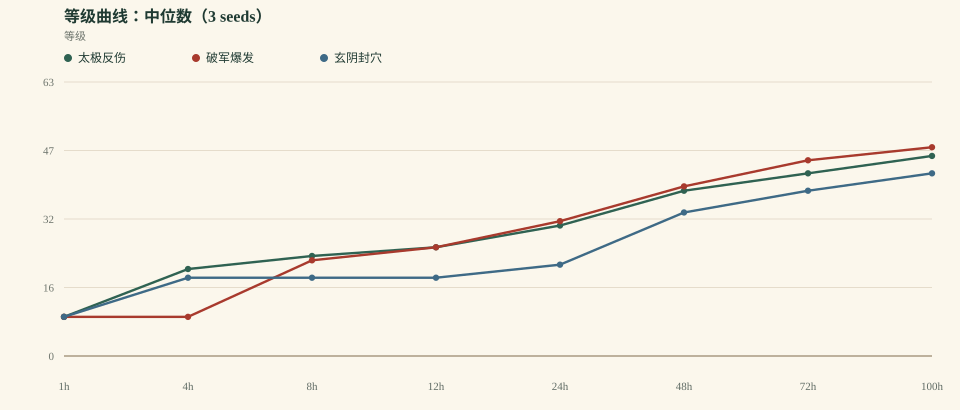
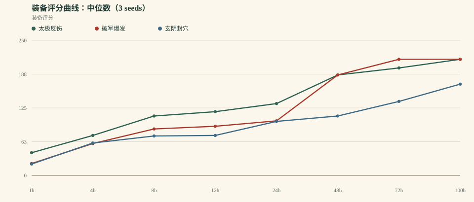
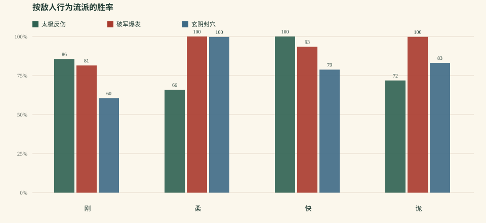

# 《一纸江湖》平衡模拟 v0.2.0

> 生成时间：2026-10-17T17:59:38.069Z  
> 规模：3 套 build × 3 seeds × 100h 连续模拟  
> 策略：aggressive bot（3 连胜推层 / 本境等级 +4 上限 / 4 连败退层）  
> 模型：0.2.0 · 自动战斗 / 守关 / 自动升级 / 自动装备 / 自动突破  
> 原始数据：`balance-v0.2.json`、`balance-v0.2.csv`

## 0. 先说结论

v0.2 把 v0.1 最伤的两个点补上了：**慢 build 的每场奖励有回合系数**，以及**太极有独立的“守关”活动**。太极从 v0.1 的 0/3 宗师变成 3/3 宗师；但玄阴掉队，整体等级差反而从 8.3% 扩大到 12.5%。这不是“平衡完成”，而是**问题从太极转移到了玄阴**。

- 100h 中位等级：**太极反伤 46** / **破军爆发 48** / **玄阴封穴 42**
- 最快/最慢刷图效率：**1.75×**
- 太极守关占比：**20.0%**；守关胜率 **100.0%**
- 当前判断：**方向对了，但整体平衡没有比 v0.1 更好；下一轮优先玄阴保命/控制、装备长线、守关玩法化。**

## 1. 方法与本版改动

- 3 套 build：太极反伤、破军爆发、玄阴封穴。
- 3 个随机种子（1, 2, 3），每套连续模拟 100 小时。
- **奖励归一化**：单场 XP/银两乘以 `1 + 0.02 × 回合数`；装备掉率也随回合小幅提高。
- **守关**：太极每 5 场进入一次“撑满 20 回合”的守关；其他 build 不打守关。守关给 XP/银两/声望/装备，但不推进地图层。
- **反爆发**：首领获得“单回合伤害不超过最大气血 18%”的护体，降低纯爆发 build 的速刷效率。
- **装备掉率**：普通/精英/首领全面下调，神/绝装概率降低。
- **机器人**：激进策略，3 连胜推层，层数上限为本境等级 +4，4 连败退层；v0.1 的保守策略结果仍保留在 [balance-v0.1.md](balance-v0.1.md)。
- 单场时间：10s + 2s × 回合数；首领额外 20s。这个时间只影响“每小时能打多少场”，不影响单场胜负。
- 限制：没有真人操作、事件/门派/同伴任务、走位与驱散、传奇效果；这是系统骨架测试。

## 2. 关键里程碑

| Build | 三流 | 二流 | 一流 | 绝顶 | 宗师 | 传说 |
| --- | --- | --- | --- | --- | --- | --- |
| 太极反伤 | 1.2h (3/3) | 3.1h (3/3) | 18.6h (3/3) | 38.0h (3/3) | 91.3h (3/3) | — (0/3) |
| 破军爆发 | 4.4h (3/3) | 5.8h (3/3) | 15.9h (3/3) | 37.5h (3/3) | 74.4h (3/3) | — (0/3) |
| 玄阴封穴 | 1.8h (3/3) | 21.9h (3/3) | 33.5h (3/3) | 64.9h (3/3) | — (0/3) | — (0/3) |

> 格式：中位到达时间（到达人数 / 总 runs）。3 seeds 下，“—”表示没有种子到达该境界。

## 3. 100h 终局

| Build | 中位等级 | 境界 | 装备评分 | 总场次 | 总败场 | 近期胜率 | 平均回合 | 最长停滞 | 最高地图 |
| --- | --- | --- | --- | --- | --- | --- | --- | --- | --- |
| 太极反伤 | 46 | 5 · 宗师 | 215 | 8087 | 216 | 100.0% | 10.6 | 6.9 | 6 图 / 10 层 |
| 破军爆发 | 48 | 5 · 宗师 | 215 | 14186 | 827 | 100.0% | 4.5 | 11.3 | 6 图 / 10 层 |
| 玄阴封穴 | 42 | 4 · 绝顶 | 169 | 11843 | 1821 | 82.0% | 8.3 | 7.7 | 5 图 / 10 层 |

## 4. 刷图效率、产出与守关

| Build | 场次/小时 | 平均回合 | 银两 | 名望 | 终局稀有度（runs × 槽） | 守关占比 / 胜率 |
| --- | --- | --- | --- | --- | --- | --- |
| 太极反伤 | 80.9 | 10.6 | 288799 | 23620 | 神:15 绝:3 | 20.0% / 100.0% |
| 破军爆发 | 141.9 | 4.5 | 380408 | 35057 | 神:18 | — |
| 玄阴封穴 | 118.4 | 8.3 | 189655 | 10931 | 绝:9 神:5 上:4 | — |

**解读**：场次/小时 × 每场奖励 = 实际成长速度；回合系数补偿了慢 build 的每场收益。守关是太极的独立收益来源，但它不应变成“唯一最优挂机点”。

## 5. 按敌人行为流派的胜率

| Build | 刚 | 柔 | 快 | 诡 |
| --- | --- | --- | --- | --- |
| 太极反伤 | 85.6% (3797) | 65.9% (4462) | 100.0% (3768) | 71.8% (12231) |
| 破军爆发 | 81.4% (10210) | 100.0% (6113) | 93.4% (5812) | 99.8% (20522) |
| 玄阴封穴 | 60.5% (2941) | 99.7% (7034) | 78.8% (8069) | 83.1% (16485) |

> 括号内是该流派在全部 run 中的总样本场次；这是整段 100h 的总胜率，不是最近 50 场。

## 6. 曲线

## 7. 发现

1. **问题从太极转移到了玄阴。** 100h 中位等级：太极反伤 46 / 破军爆发 48 / 玄阴封穴 42；等级差 12.5%，比 v0.1 的 8.3% 更大。太极被守关/回合系数拉起来了，但玄阴封穴掉队；破军爆发仍然最快。
2. **守关把太极从“慢 DPS”里救出来了。** 太极的守关场次占比 20.0%，守关胜率 100.0%；它达到宗师的中位时间是 91.3h。这验证了“坦系独立活动”的方向；但当前守关只是“撑满 20 回合”，还可以被纯防御策略利用。
3. **破军被加了风险，但仍然快。** 破军场次/小时 141.9，总失败中位 827 场；首领 18% 单回合伤害封顶把它的爆发拖慢了，但它依然是最快曲线。需要继续观察“快”是否仍然等于“最优”。
4. **玄阴是下一轮的首要问题。** 玄阴总失败中位 1821 场，近期胜率 82.0%，100h 停在 4 境；控制和毒在高层需要更可靠的保命/命中，否则它会在激进推层里被反复打回。
5. **装备仍然是 100h 内接近满稀有。** 终局装备样本 54 件中，神/绝占比仍然高；掉率已经下调，但“毕业”还没有变成多周目标。下一步需要把神装/传奇效果绑定到更深的层、天机榜或赛季，而不是普通首领。
6. **激进 bot 让问题更明显。** 当前策略是 3 连胜推层、层数上限为本境等级 +4、连败 4 次才退；近期胜率约 太极反伤 100.0% / 破军爆发 100.0% / 玄阴封穴 82.0%。这比 v0.1 的保守策略更接近“玩家会去试上限”，但仍不是极限打法。

## 8. 下一轮调整建议（按优先级）

1. **继续调守关收益**：太极的守关场次已占一部分；如果它仍然只靠守关追等级，降低守关 XP、提高守关装备/声望权重，让它成为“补装备/补声望”而不是“主升级路径”。
2. **给玄阴补一个保命/控制命中机制**：例如封穴对首领的递减上限、毒层转化为护体，或提高身法在高层的作用；先让它 100h 能稳定到宗师。
3. **把破军的“快”变成有代价的快**：首领伤害封顶已经生效；下一轮可加“高层精英反伤/破甲抵抗”或让速刷在高层更容易翻车，目标是近期胜率 75–85%。
4. **装备长线化**：神装/传奇效果绑定深层、天机榜、武林大会；普通首领只出绝/上，避免 100h 内满神装。
5. **守关扩成真正的玩法**：从“撑 20 回合”扩成波次、护镖、守山门；让坦系有可展示的独立目标，而不是一个隐藏奖励。
6. **扩 build 与敌人风格**：当前 3 套、4 种行为风格；验证完曲线后再扩，不要先堆内容。

## 9. 模型边界

- 只有 3 套 build；自动优先级是硬编码启发式，不是玩家真实决策。
- 守关目前是“打不死的守关者 + 撑满 20 回合”，不是波次/护镖；它可以被纯防御策略利用。
- 装备自动穿最优、自动淬炼、无套装收集选择；传奇效果仍未进入战斗（只有套装 2/4 件）。
- 没有门派/声望/事件/同伴个人任务的长期影响；同伴只作为战斗被动的来源。
- 战斗是回合制抽象：没有走位、控制链、驱散、属性抗性、首领多阶段机制；首领只有 50% 狂暴与 18% 单回合伤害封顶。
- 机器人连续在线 100h、无操作损耗；真人会慢很多，所以曲线是“上限参考”，不是玩家日历。
- 奖励按每场结算并加回合系数，不是真正的时间收益模型；这是 v0.2 的过渡方案。

## 10. 数据说明

- `balance-v0.2.json`：完整聚合与每次 run 的终局/快照。
- `balance-v0.2.csv`：每次 run 的终局摘要。
- v0.1 基线：[balance-v0.1.md](balance-v0.1.md)。
- 本报告中的所有时间都是**连续模拟小时**，不是玩家日历；真人每天 1–2 小时，体感会慢 5–10 倍。
- 下一轮先改系统，再改内容；不要用更多事件去掩盖结构问题。
