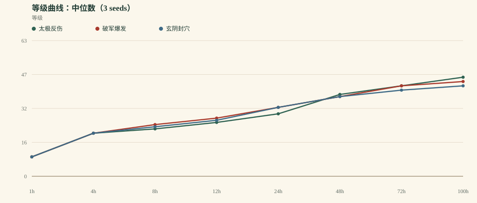
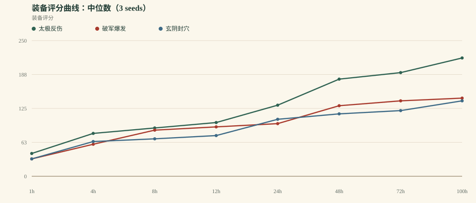
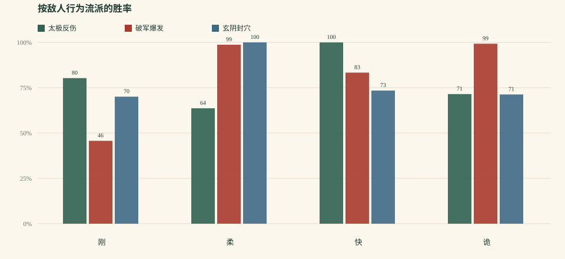

# 《一纸江湖》平衡模拟 v0.3.0

> 生成时间：2026-10-17T18:03:27.959Z  
> 规模：3 套 build × 3 seeds × 100h 连续模拟  
> 策略：aggressive bot（3 连胜推层 / 本境等级 +4 上限 / 4 连败退层）  
> 模型：0.3.0 · 自动战斗 / 守关 / 反震 / 自动升级 / 自动装备 / 自动突破  
> 原始数据：`balance-v0.3.json`、`balance-v0.3.csv`

## 0. 先说结论

v0.3 的目标是“把玄阴拉回来，同时不把破军放出来”。结果只做到一半：**玄阴没有追上来，破军被反震/装备门槛/试炼压过头，只有太极稳定在宗师。** 这轮修好了“卡死”，但没有修好“谁最强”。

- 100h 中位等级：**太极反伤 46** / **破军爆发 44** / **玄阴封穴 42**
- 最快/最慢刷图效率：**1.80×**
- 太极守关占比：**20.0%**；守关胜率 **100.0%**
- 当前判断：**v0.3 没有通过验收。** 保留试炼感悟与装备门槛；下一轮不要继续加码削破军，而要重做玄阴的输出/保命结构，并把反震从“纯惩罚”改成“有应对的机制”。

## 1. 方法与本版改动

- 3 套 build：太极反伤、破军爆发、玄阴封穴。
- 3 个随机种子（1, 2, 3），每套连续模拟 100 小时。
- **奖励归一化**：单场 XP/银两乘以 `1 + 0.02 × 回合数`；装备掉率也随回合小幅提高。
- **守关**：太极每 5 场进入一次“撑满 20 回合”的守关；其他 build 不打守关。守关给 XP/银两/声望/装备，但不推进地图层。
- **反爆发**：首领获得“单回合伤害不超过最大气血 18%”的护体；反震 8% 伤害，但单次反震最多扣 3% 气血。
- **装备掉率**：普通/精英/首领全面下调；神装要求“首领 + 5 图以上 + 9 层以上”，绝装要求 3 图以上，避免早期满稀有。
- **试炼感悟**：连续突破失败会降低下一次试炼难度（最多 5 层），防止任何 build 被硬锁在境界门口。
- **玄阴修复**：基础气血/防御上调，毒经提供“按毒层减伤”。结果证明只补生存不够，它还需要输出/控制命中或独立活动。
- **机器人**：激进策略，3 连胜推层，层数上限为本境等级 +4，4 连败退层；v0.1 的保守策略结果仍保留在 [balance-v0.1.md](balance-v0.1.md)。
- 单场时间：10s + 2s × 回合数；首领额外 20s。这个时间只影响“每小时能打多少场”，不影响单场胜负。
- 限制：没有真人操作、事件/门派/同伴任务、走位与驱散、传奇效果；这是系统骨架测试。

## 2. 关键里程碑

| Build | 三流 | 二流 | 一流 | 绝顶 | 宗师 | 传说 |
| --- | --- | --- | --- | --- | --- | --- |
| 太极反伤 | 1.2h (3/3) | 3.0h (3/3) | 19.1h (3/3) | 39.6h (3/3) | 93.2h (3/3) | — (0/3) |
| 破军爆发 | 1.0h (3/3) | 2.5h (3/3) | 13.0h (3/3) | 43.9h (3/3) | — (0/3) | — (0/3) |
| 玄阴封穴 | 1.2h (3/3) | 2.7h (3/3) | 15.2h (3/3) | 45.5h (3/3) | — (0/3) | — (0/3) |

> 格式：中位到达时间（到达人数 / 总 runs）。3 seeds 下，“—”表示没有种子到达该境界。

## 3. 100h 终局

| Build | 中位等级 | 境界 | 装备评分 | 总场次 | 总败场 | 近期胜率 | 平均回合 | 最长停滞 | 最高地图 |
| --- | --- | --- | --- | --- | --- | --- | --- | --- | --- |
| 太极反伤 | 46 | 5 · 宗师 | 218 | 7868 | 270 | 100.0% | 11.0 | 6.9 | 6 图 / 10 层 |
| 破军爆发 | 44 | 4 · 绝顶 | 144 | 14193 | 2629 | 74.0% | 6.0 | 11.4 | 5 图 / 10 层 |
| 玄阴封穴 | 42 | 4 · 绝顶 | 139 | 11508 | 2525 | 80.0% | 10.0 | 9.8 | 5 图 / 10 层 |

## 4. 刷图效率、产出与守关

| Build | 场次/小时 | 平均回合 | 银两 | 名望 | 终局稀有度（runs × 槽） | 守关占比 / 胜率 |
| --- | --- | --- | --- | --- | --- | --- |
| 太极反伤 | 78.7 | 11.0 | 280082 | 23105 | 绝:3 神:15 | 20.0% / 100.0% |
| 破军爆发 | 141.9 | 6.0 | 163917 | 12121 | 上:11 绝:7 | — |
| 玄阴封穴 | 115.1 | 10.0 | 163806 | 9090 | 上:5 绝:12 神:1 | — |

**解读**：场次/小时 × 每场奖励 = 实际成长速度；回合系数补偿了慢 build 的每场收益。守关是太极的独立收益来源，但它不应变成“唯一最优挂机点”。

## 5. 按敌人行为流派的胜率

| Build | 刚 | 柔 | 快 | 诡 |
| --- | --- | --- | --- | --- |
| 太极反伤 | 80.3% (4537) | 63.7% (3847) | 100.0% (3689) | 71.5% (11583) |
| 破军爆发 | 45.7% (10716) | 98.7% (3243) | 83.3% (11664) | 99.3% (16934) |
| 玄阴封穴 | 70.1% (1767) | 100.0% (7914) | 73.4% (4254) | 71.3% (20508) |

> 括号内是该流派在全部 run 中的总样本场次；这是整段 100h 的总胜率，不是最近 50 场。

## 6. 曲线

## 7. 发现

1. **玄阴没有追上。** 100h 中位等级：太极反伤 46 / 破军爆发 44 / 玄阴封穴 42；等级差 8.7%。玄阴封穴仍在最后，而且 100h 停在 4 境；只补气血/毒减伤没有解决它的核心问题。
2. **守关把太极推到了第一。** 太极守关占比 20.0%，守关胜率 100.0%，中位等级 46；它达到宗师 93.2h。方向成立，但守关的 XP 权重可能偏高，下一步要把收益从“等级”挪到“装备/声望”。
3. **破军被压过头了。** 破军从 v0.2 的 48 级/宗师掉到 44 级/4 境，总失败中位 2629 场、近期胜率 74.0%。反震、装备门槛和试炼叠加在一起，惩罚超过了它的收益；“快”没有变成“有代价”，而是“被卡住”。
4. **试炼感悟是这轮最该保留的系统。** 破军和玄阴都曾在境界门口硬锁；试炼难度随失败下降后，曲线才重新动起来。它没有掩盖 build 差距，但避免了“一个 build 永远无法进入下一境”的死局。
5. **装备门槛生效，但长线仍不够。** 终局装备样本 54 件中，破军已经只到上/绝、没有神装；太极和玄阴仍有较多神/绝。神装不能再靠普通首领刷，应该绑到深层首通、天机榜或武林大会。
6. **激进 bot 让问题更明显。** 当前策略是 3 连胜推层、层数上限为本境等级 +4、连败 4 次才退；近期胜率约 太极反伤 100.0% / 破军爆发 74.0% / 玄阴封穴 80.0%。这比 v0.1 的保守策略更接近“玩家会去试上限”，但仍不是极限打法。

## 8. 下一轮调整建议（按优先级）

1. **玄阴要重做，不是再加一点血**：把毒层做成“护体/回复/控制命中”的资源，或者给玄阴一个独立的控制/消耗玩法；只加 HP/防御已经被证明不够。
2. **破军要回调，不是继续削**：反震从 8% 降到 4% 左右，或只在高阶层数生效；中阶装备门槛放宽一点，让破军能在 100h 内重新摸到宗师，但不要再回到 48 级一枝独秀。
3. **太极的守关收益要从等级挪到装备/声望**：守关应成为坦系的“补装备/补声望”活动，而不是最快升级路径；否则它会把排行榜又拉成单极。
4. **装备长线化**：保留 5 图/9 层的神装门槛；把传奇效果绑到深层首通、天机榜、武林大会，普通首领只出绝/上。
5. **守关扩成真正的玩法**：从“撑 20 回合”扩成波次、护镖、守山门；让坦系有可展示的独立目标，而不是一个隐藏奖励。
6. **暂不扩内容**：先把 3 套 build 的曲线跑平；当前问题都是系统问题，加事件/地图不会解决。

## 9. 模型边界

- 只有 3 套 build；自动优先级是硬编码启发式，不是玩家真实决策。
- 守关目前是“打不死的守关者 + 撑满 20 回合”，不是波次/护镖；它可以被纯防御策略利用。
- 装备自动穿最优、自动淬炼、无套装收集选择；传奇效果仍未进入战斗（只有套装 2/4 件）。
- 没有门派/声望/事件/同伴个人任务的长期影响；同伴只作为战斗被动的来源。
- 战斗是回合制抽象：没有走位、控制链、驱散、属性抗性、首领多阶段机制；首领只有 50% 狂暴与 18% 单回合伤害封顶。
- 机器人连续在线 100h、无操作损耗；真人会慢很多，所以曲线是“上限参考”，不是玩家日历。
- 奖励按每场结算并加回合系数，不是真正的时间收益模型；这是 v0.3 的过渡方案。
- 突破试炼失败会降难度；它避免硬锁，但也可能让“卡境界”的压力低于设计意图。

## 10. 数据说明

- `balance-v0.3.json`：完整聚合与每次 run 的终局/快照。
- `balance-v0.3.csv`：每次 run 的终局摘要。
- v0.2 基线：[balance-v0.2.md](balance-v0.2.md)；v0.1 基线：[balance-v0.1.md](balance-v0.1.md)。
- 本报告中的所有时间都是**连续模拟小时**，不是玩家日历；真人每天 1–2 小时，体感会慢 5–10 倍。
- 下一轮先改系统，再改内容；不要用更多事件去掩盖结构问题。
