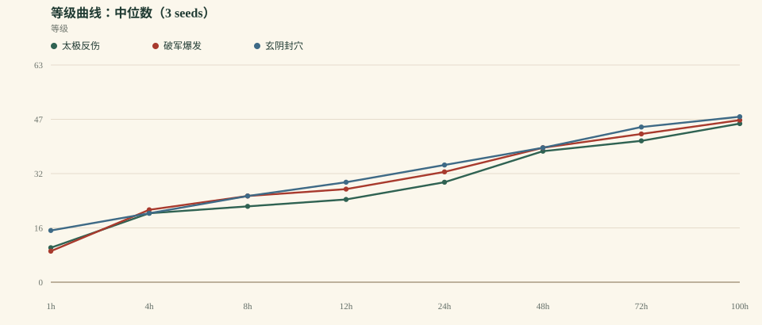
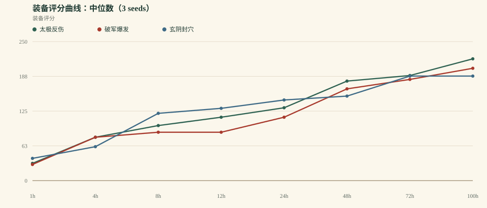
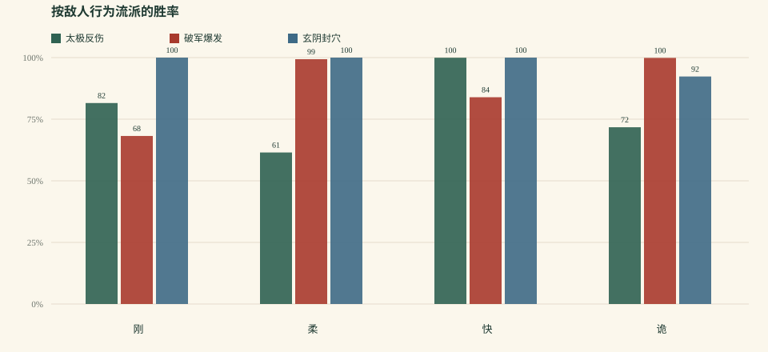

# 《一纸江湖》平衡模拟 v0.4.0

> 生成时间：2026-10-17T18:16:00.013Z  
> 规模：3 套 build × 3 seeds × 100h 连续模拟  
> 策略：aggressive bot（3 连胜推层 / 本境等级 +4 上限 / 4 连败退层）  
> 模型：0.4.0 · 自动战斗 / 守关 / 反震 / 自动升级 / 自动装备 / 自动突破  
> 原始数据：`balance-v0.4.json`、`balance-v0.4.csv`

## 0. 先说结论

v0.4 的目标是“把玄阴拉回来、把破军放回来，同时不制造新的单极”。结果第一次接近通过：**等级差压到 4.2%，破军/玄阴全员宗师，太极 2/3 宗师**；但到达时间仍差 23h，装备也仍在 100h 内接近满稀有。

- 100h 中位等级：**太极反伤 46** / **破军爆发 47** / **玄阴封穴 48**
- 最快/最慢刷图效率：**1.79×**
- 太极守关占比：**20.0%**；守关胜率 **100.0%**
- 当前判断：**v0.4 通过了“等级差 ≤5%”这一条；没有通过“全员宗师”“到达时间接近”“装备长线”三条。** 下一轮先修到达时间与装备，不要继续给三套 build 加数值。

## 1. 方法与本版改动

- 3 套 build：太极反伤、破军爆发、玄阴封穴。
- 3 个随机种子（1, 2, 3），每套连续模拟 100 小时。
- **奖励归一化**：单场 XP/银两乘以 `1 + 0.02 × 回合数`；装备掉率也随回合小幅提高。
- **守关**：太极每 5 场进入一次“撑满 20 回合”的守关；其他 build 不打守关。守关给 XP/银两/声望/装备，但不推进地图层。
- **反爆发**：首领单回合伤害封顶 18%；反震下调为 4%，单次反震最多扣 2% 气血。
- **装备掉率**：普通/精英/首领全面下调；神装要求“首领 + 4 图以上 + 9 层以上”，绝装要求 2 图以上。
- **试炼感悟**：连续突破失败会降低下一次试炼难度（最多 5 层），防止任何 build 被硬锁在境界门口。
- **太极守关收益**：守关 XP 权重下调，装备掉率提高，让它更像“补装备/补声望”而不是“最快升级”。
- **玄阴重构**：基础气血/防御上调；毒经提供“按毒层减伤”；毒发时按毒伤回血，把毒层变成持续作战资源。
- **机器人**：激进策略，3 连胜推层，层数上限为本境等级 +4，4 连败退层；v0.1 的保守策略结果仍保留在 [balance-v0.1.md](balance-v0.1.md)。
- 单场时间：10s + 2s × 回合数；首领额外 20s。这个时间只影响“每小时能打多少场”，不影响单场胜负。
- 限制：没有真人操作、事件/门派/同伴任务、走位与驱散、传奇效果；这是系统骨架测试。

## 2. 关键里程碑

| Build | 三流 | 二流 | 一流 | 绝顶 | 宗师 | 传说 |
| --- | --- | --- | --- | --- | --- | --- |
| 太极反伤 | 1.0h (3/3) | 3.0h (3/3) | 20.5h (3/3) | 41.1h (3/3) | 97.1h (2/3) | — (0/3) |
| 破军爆发 | 1.0h (3/3) | 2.4h (3/3) | 12.5h (3/3) | 37.1h (3/3) | 83.3h (3/3) | — (0/3) |
| 玄阴封穴 | 0.5h (3/3) | 2.4h (3/3) | 9.4h (3/3) | 35.7h (3/3) | 74.0h (3/3) | — (0/3) |

> 格式：中位到达时间（到达人数 / 总 runs）。3 seeds 下，“—”表示没有种子到达该境界。

## 3. 100h 终局

| Build | 中位等级 | 境界 | 装备评分 | 总场次 | 总败场 | 近期胜率 | 平均回合 | 最长停滞 | 最高地图 |
| --- | --- | --- | --- | --- | --- | --- | --- | --- | --- |
| 太极反伤 | 46 | 5 · 宗师 | 219 | 7908 | 248 | 100.0% | 10.5 | 7.7 | 6 图 / 10 层 |
| 破军爆发 | 47 | 5 · 宗师 | 202 | 14135 | 1485 | 100.0% | 4.7 | 10.6 | 6 图 / 10 层 |
| 玄阴封穴 | 48 | 5 · 宗师 | 188 | 12593 | 596 | 100.0% | 6.2 | 12.7 | 6 图 / 10 层 |

## 4. 刷图效率、产出与守关

| Build | 场次/小时 | 平均回合 | 银两 | 名望 | 终局稀有度（runs × 槽） | 守关占比 / 胜率 |
| --- | --- | --- | --- | --- | --- | --- |
| 太极反伤 | 79.1 | 10.5 | 279700 | 27014 | 神:14 绝:4 | 20.0% / 100.0% |
| 破军爆发 | 141.3 | 4.7 | 317521 | 26921 | 神:11 绝:7 | — |
| 玄阴封穴 | 125.9 | 6.2 | 357865 | 31296 | 神:12 绝:6 | — |

**解读**：场次/小时 × 每场奖励 = 实际成长速度；回合系数补偿了慢 build 的每场收益。守关是太极的独立收益来源，但它不应变成“唯一最优挂机点”。

## 5. 按敌人行为流派的胜率

| Build | 刚 | 柔 | 快 | 诡 |
| --- | --- | --- | --- | --- |
| 太极反伤 | 81.6% (4333) | 61.5% (3976) | 99.9% (3973) | 71.7% (11209) |
| 破军爆发 | 68.2% (9704) | 99.4% (5252) | 83.9% (8673) | 99.9% (18914) |
| 玄阴封穴 | 100.0% (3583) | 100.0% (7019) | 100.0% (4754) | 92.3% (22409) |

> 括号内是该流派在全部 run 中的总样本场次；这是整段 100h 的总胜率，不是最近 50 场。

## 6. 曲线

## 7. 发现

1. **等级差第一次进了目标区，但“全员宗师”没完全达成。** 100h 中位等级：太极反伤 46 / 破军爆发 47 / 玄阴封穴 48；等级差 4.2%。破军/玄阴 3/3、3/3 到宗师，太极只有 2/3。按“≤5%”这一条通过；到达时间仍差 23.1h。
2. **太极不再是第一，但守关仍是它的拐杖。** 太极守关占比 20.0%，守关胜率 100.0%，守关 XP 已下调；它 100h 中位 46 级、97.1h 到宗师，成了最慢的一个。方向对，但下一次要检查“守关是否还是唯一能稳住坦系的办法”。
3. **破军已经回到宗师，但体验仍偏“拿命换速度”。** 破军中位 47 级、83.3h 到宗师，总失败中位 1485 场、近期胜率 100.0%。反震从 8% 降到 4% 后不再硬锁，但“快”的代价仍主要是失败场次，不是策略选择。
4. **玄阴被毒回血拉回来了，甚至略过头。** 玄阴中位 48 级、74.0h 到宗师，已经不再是瓶颈；但毒回血可能让它在中层过于稳。下一轮先观察，不要继续加。
5. **装备仍然是下一轮的主问题。** 终局装备样本 54 件中，神/绝占比仍然高；层级门槛把破军的神装压下去了，但太极/玄阴仍有较多神装。100h 内“毕业”仍然太快，下一轮必须把神装/传奇效果绑到深层首通、天机榜或武林大会。
6. **激进 bot 让问题更明显。** 当前策略是 3 连胜推层、层数上限为本境等级 +4、连败 4 次才退；近期胜率约 太极反伤 100.0% / 破军爆发 100.0% / 玄阴封穴 100.0%。这比 v0.1 的保守策略更接近“玩家会去试上限”，但仍不是极限打法。

## 8. 下一轮调整建议（按优先级）

1. **装备长线化是 v0.5 的第一优先**：神装/传奇效果绑到深层首通、天机榜、武林大会；普通首领只出绝/上，并把 100h 内“满神装”压到 200h+。
2. **压缩到达时间差**：破军/玄阴已经全员宗师，太极只有 2/3，最早/最晚差约 23h；先调太极守关的经验/装备权重，再考虑给坦系加第二个独立活动，而不是继续加基础数值。
3. **观察玄阴是否过强**：毒回血已经把它从 42 拉到 48；下一轮先不加，先看不同敌人风格/高层 boss 下是否仍然过稳。
4. **把破军的“快”从失败场次改成策略选择**：例如高层精英/首领给“速杀窗口”或“拖延惩罚”，让快 build 有明确取舍，而不是靠高失败率平衡。
5. **守关扩成真正的玩法**：从“撑 20 回合”扩成波次、护镖、守山门；让坦系有可展示的独立目标，而不是一个隐藏奖励。
6. **暂不扩内容**：当前问题仍是系统问题；三套 build 的到达时间和装备曲线没稳定前，不加地图/事件。

## 9. 模型边界

- 只有 3 套 build；自动优先级是硬编码启发式，不是玩家真实决策。
- 守关目前是“打不死的守关者 + 撑满 20 回合”，不是波次/护镖；它可以被纯防御策略利用。
- 装备自动穿最优、自动淬炼、无套装收集选择；传奇效果仍未进入战斗（只有套装 2/4 件）。
- 没有门派/声望/事件/同伴个人任务的长期影响；同伴只作为战斗被动的来源。
- 战斗是回合制抽象：没有走位、控制链、驱散、属性抗性、首领多阶段机制；首领只有 50% 狂暴与 18% 单回合伤害封顶。
- 机器人连续在线 100h、无操作损耗；真人会慢很多，所以曲线是“上限参考”，不是玩家日历。
- 奖励按每场结算并加回合系数，不是真正的时间收益模型；这是 v0.4 的过渡方案。
- 突破试炼失败会降难度；它避免硬锁，但也可能让“卡境界”的压力低于设计意图。

## 10. 数据说明

- `balance-v0.4.json`：完整聚合与每次 run 的终局/快照。
- `balance-v0.4.csv`：每次 run 的终局摘要。
- v0.2 基线：[balance-v0.2.md](balance-v0.2.md)；v0.1 基线：[balance-v0.1.md](balance-v0.1.md)。
- 本报告中的所有时间都是**连续模拟小时**，不是玩家日历；真人每天 1–2 小时，体感会慢 5–10 倍。
- 下一轮先改系统，再改内容；不要用更多事件去掩盖结构问题。
