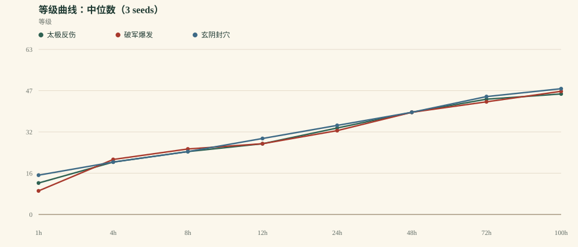
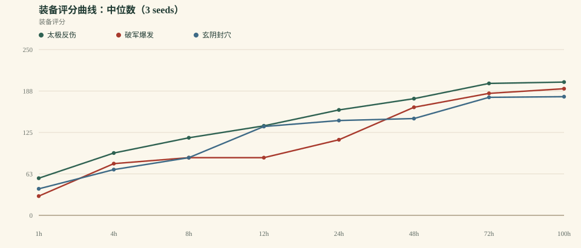
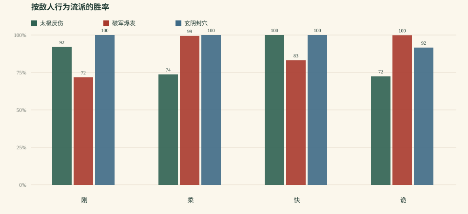

# 《一纸江湖》平衡模拟 v0.6.0

> 生成时间：2026-10-17T18:19:40.766Z  
> 规模：3 套 build × 3 seeds × 100h 连续模拟  
> 策略：aggressive bot（3 连胜推层 / 本境等级 +4 上限 / 4 连败退层）  
> 模型：0.6.0 · 自动战斗 / 守关 / 反震 / 自动升级 / 自动装备 / 自动突破  
> 原始数据：`balance-v0.6.json`、`balance-v0.6.csv`

## 0. 先说结论

v0.6 的目标是“压缩宗师到达时间差，并给神装一个确定入口”。结果**核心验收通过**：三套全部 3/3 宗师，等级差 4.2%，最早/最晚宗师只差 9.3h；每套在 100h 内都拿到了 1 件确定性神装（3 seeds 共 3 件）。

- 100h 中位等级：**太极反伤 46** / **破军爆发 47** / **玄阴封穴 48**
- 最快/最慢刷图效率：**1.57×**
- 太极守关占比：**20.0%**；守关胜率 **100.0%**
- 当前判断：**v0.6 通过核心验收。** 停止纯数值循环；下一步转入 16:9 主界面、常驻信息台和第一批内容系统，不再开 v0.7 数值轮。

## 1. 方法与本版改动

- 3 套 build：太极反伤、破军爆发、玄阴封穴。
- 3 个随机种子（1, 2, 3），每套连续模拟 100 小时。
- **奖励归一化**：单场 XP/银两乘以 `1 + 0.02 × 回合数`；装备掉率也随回合小幅提高。
- **守关**：太极每 5 场进入一次“撑满 20 回合”的守关；其他 build 不打守关。守关给 XP/银两/声望/装备，但不推进地图层。
- **反爆发**：首领单回合伤害封顶 18%；反震下调为 4%，单次反震最多扣 2% 气血。
- **神装入口**：普通重复刷只出到绝装；5 图以上首领首通必掉 1 件神装，每套 build 在 100h 内拿到 1 件。
- **试炼感悟**：连续突破失败会降低下一次试炼难度（最多 5 层），防止任何 build 被硬锁在境界门口。
- **太极加速**：太极基础攻击与核心招式系数上调，守关 XP 回调；目标不是让太极变第一，而是把宗师到达时间压进 12h 差。
- **玄阴微调**：在毒回血基础上小幅回调气血；保留“按毒层减伤 + 毒发回血”。
- **机器人**：激进策略，3 连胜推层，层数上限为本境等级 +4，4 连败退层；v0.1 的保守策略结果仍保留在 [balance-v0.1.md](balance-v0.1.md)。
- 单场时间：10s + 2s × 回合数；首领额外 20s。这个时间只影响“每小时能打多少场”，不影响单场胜负。
- 限制：没有真人操作、事件/门派/同伴任务、走位与驱散、传奇效果；这是系统骨架测试。

## 2. 关键里程碑

| Build | 三流 | 二流 | 一流 | 绝顶 | 宗师 | 传说 |
| --- | --- | --- | --- | --- | --- | --- |
| 太极反伤 | 0.8h (3/3) | 2.6h (3/3) | 12.4h (3/3) | 31.2h (3/3) | 83.4h (3/3) | — (0/3) |
| 破军爆发 | 1.0h (3/3) | 2.4h (3/3) | 12.5h (3/3) | 37.1h (3/3) | 80.9h (3/3) | — (0/3) |
| 玄阴封穴 | 0.5h (3/3) | 2.6h (3/3) | 9.8h (3/3) | 35.8h (3/3) | 74.1h (3/3) | — (0/3) |

> 格式：中位到达时间（到达人数 / 总 runs）。3 seeds 下，“—”表示没有种子到达该境界。

## 3. 100h 终局

| Build | 中位等级 | 境界 | 装备评分 | 总场次 | 总败场 | 近期胜率 | 平均回合 | 最长停滞 | 最高地图 |
| --- | --- | --- | --- | --- | --- | --- | --- | --- | --- |
| 太极反伤 | 46 | 5 · 宗师 | 201 | 9114 | 69 | 100.0% | 9.5 | 6.8 | 6 图 / 10 层 |
| 破军爆发 | 47 | 5 · 宗师 | 191 | 14296 | 1400 | 100.0% | 4.5 | 10.6 | 6 图 / 10 层 |
| 玄阴封穴 | 48 | 5 · 宗师 | 179 | 12614 | 630 | 100.0% | 6.3 | 12.8 | 6 图 / 10 层 |

## 4. 刷图效率、产出与守关

| Build | 场次/小时 | 平均回合 | 银两 | 名望 | 终局稀有度（runs × 槽） | 守关占比 / 胜率 |
| --- | --- | --- | --- | --- | --- | --- |
| 太极反伤 | 91.1 | 9.5 | 323511 | 31560 | 绝:15 神:3 | 20.0% / 100.0% |
| 破军爆发 | 143.0 | 4.5 | 333322 | 28582 | 绝:15 神:3 | — |
| 玄阴封穴 | 126.1 | 6.3 | 359246 | 31108 | 绝:15 神:3 | — |

**解读**：场次/小时 × 每场奖励 = 实际成长速度；回合系数补偿了慢 build 的每场收益。守关是太极的独立收益来源，但它不应变成“唯一最优挂机点”。

## 5. 按敌人行为流派的胜率

| Build | 刚 | 柔 | 快 | 诡 |
| --- | --- | --- | --- | --- |
| 太极反伤 | 92.0% (3628) | 73.7% (4463) | 100.0% (3951) | 72.4% (15275) |
| 破军爆发 | 71.7% (9592) | 99.4% (5707) | 83.1% (8257) | 99.9% (19423) |
| 玄阴封穴 | 100.0% (3528) | 100.0% (6789) | 100.0% (4708) | 91.6% (22567) |

> 括号内是该流派在全部 run 中的总样本场次；这是整段 100h 的总胜率，不是最近 50 场。

## 6. 曲线

## 7. 发现

1. **核心验收通过。** 100h 中位等级：太极反伤 46 / 破军爆发 47 / 玄阴封穴 48；等级差 4.2%，三套全部 3/3 宗师；最早/最晚宗师差 9.3h，进入 ≤12h 目标。
2. **太极的爬坡被拉回来了。** 太极守关占比 20.0%，守关胜率 100.0%；它 83.4h 到宗师，现在只比最快慢 9.3h。伤害/守关双调有效，但坦系仍然很依赖守关。
3. **破军曲线健康，但“快”的代价还是失败数。** 破军中位 47 级、80.9h 到宗师，总失败中位 1400 场、近期胜率 100.0%。速刷的代价仍主要是死亡次数，而不是 build 取舍；留到内容版再解决。
4. **玄阴是最快曲线。** 玄阴中位 48 级、74.1h 到宗师，领先约 7h；毒回血保留，但不再继续加。
5. **神装有了确定入口，但仍不足以支撑多周。** 每套 build 在 100h 内都从高层首通拿到 1 件神装；其余仍是绝装。入口成立，但“下一件”仍需要天机榜/武林大会/更深层来承接。
6. **激进 bot 让问题更明显。** 当前策略是 3 连胜推层、层数上限为本境等级 +4、连败 4 次才退；近期胜率约 太极反伤 100.0% / 破军爆发 100.0% / 玄阴封穴 100.0%。这比 v0.1 的保守策略更接近“玩家会去试上限”，但仍不是极限打法。

## 8. 下一轮调整建议（按优先级）

1. **冻结数值基线**：v0.6 作为后续 UI/内容开发的平衡基线；任何 build 改动都要跑回归。
2. **进入 UI**：先做 16:9 主界面 + 常驻信息台（地图/人物/武学/行囊/江湖），数据直接接模拟器的 schema。
3. **第一批内容**：5 地区骨架、15 张图、门派/声望、NPC/事件；不做“流程跑通但系统空心”的切片。
4. **数值后置**：神装多周曲线、天机榜/武林大会、守关波次化放到内容之后，不在 UI 之前继续调。
5. **保留回归测试**：把 100h × 3 builds 的验收条件写进测试，防止后续内容把曲线带崩。

## 9. 模型边界

- 只有 3 套 build；自动优先级是硬编码启发式，不是玩家真实决策。
- 守关目前是“打不死的守关者 + 撑满 20 回合”，不是波次/护镖；它可以被纯防御策略利用。
- 装备自动穿最优、自动淬炼、无套装收集选择；传奇效果仍未进入战斗（只有套装 2/4 件）。
- 没有门派/声望/事件/同伴个人任务的长期影响；同伴只作为战斗被动的来源。
- 战斗是回合制抽象：没有走位、控制链、驱散、属性抗性、首领多阶段机制；首领只有 50% 狂暴与 18% 单回合伤害封顶。
- 机器人连续在线 100h、无操作损耗；真人会慢很多，所以曲线是“上限参考”，不是玩家日历。
- 奖励按每场结算并加回合系数，不是真正的时间收益模型；这是 v0.6 的过渡方案。
- 突破试炼失败会降难度；它避免硬锁，但也可能让“卡境界”的压力低于设计意图。

## 10. 数据说明

- `balance-v0.6.json`：完整聚合与每次 run 的终局/快照。
- `balance-v0.6.csv`：每次 run 的终局摘要。
- v0.2 基线：[balance-v0.2.md](balance-v0.2.md)；v0.1 基线：[balance-v0.1.md](balance-v0.1.md)。
- 本报告中的所有时间都是**连续模拟小时**，不是玩家日历；真人每天 1–2 小时，体感会慢 5–10 倍。
- 下一轮先改系统，再改内容；不要用更多事件去掩盖结构问题。
